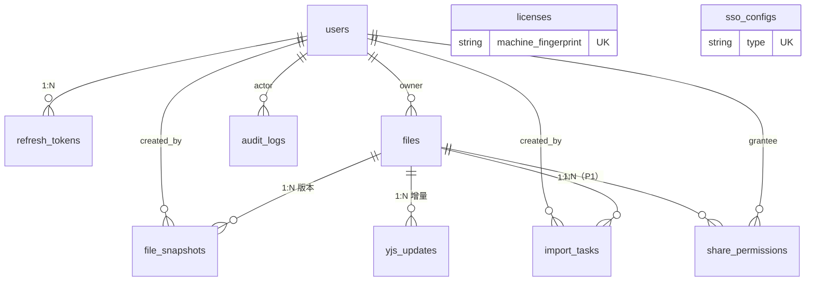

# 数据模型细化 schema.md（TypeORM Entity + 信创库兼容核对）

> 产出人：高见远（首席架构师） | 依据：Spec-web-office-v1.md 第 6 章（锁定 10 张表）+ 第 10 章数据层约束
> 版本锚定：TypeORM 0.3.x / 开发期 PostgreSQL 16 / 生产 KingbaseES V8 R6（备选 openGauss 5.x）
> 硬约束（Spec 锁定）：**禁用 PG 专有特性**——JSON 一律 `text` 存字符串、无数组字段、无 JSONB/pgvector、无 PG 扩展函数依赖

---

## 1. 全局约定

| 项 | 约定 | 原因 |
|---|---|---|
| 主键 | `uuid`，**应用层生成（uuid v4）**，`@PrimaryColumn('uuid')` | 避免 `gen_random_uuid()`/`uuid-ossp` 扩展依赖（KingbaseES 扩展支持面需逐项验证，应用层生成零风险） |
| 自增 | 不使用数据库 serial/identity 作为主键；`seq` 等业务序号由应用层在事务内 `max(seq)+1` 分配 | serial 语法在国产库兼容面不一致；且协同场景需要 (file_id, seq) 连续可控序 |
| 时间 | `timestamp(6) with time zone`，应用层统一写 UTC；`@CreateDateColumn`/`@UpdateDateColumn` 由 TypeORM 填充（应用层时间） | timestamptz 两库均支持，但行为需在核对清单验证（见 4.2） |
| JSON | `text` 列 + 应用层 `JSON.stringify/parse` | Spec 硬约束 |
| 二进制 | `bytea` | PG 血统两库均支持；达梦为 BLOB（差异见 dameng-poc-plan.md） |
| 命名 | 表名蛇形复数、列蛇形；Entity 类名 PascalCase | TypeORM `namingStrategy: SnakeNamingStrategy`（显式配置） |
| 软删除 | 仅 `files.deleted_at`（业务上唯一需要软删的表）；审计日志只追加不删改 | Spec |
| 迁移 | `synchronize: false`，migration 生成的 SQL 过「禁 PG 专有特性」lint（见第 5 节） | CI 双跑 PG + KingbaseES 兼容用例（Spec 第 10 章） |

## 2. ER 图（Mermaid）



## 3. Entity 定义（TypeORM 0.3.x，src/entities/）

> 以下为契约代码：字段名、类型、索引、关联以此为准，实现时逐字面拷贝再补 repository。

### 3.1 users（用户）

```typescript
import { Entity, PrimaryColumn, Column, Index, CreateDateColumn, UpdateDateColumn } from 'typeorm';

@Entity('users')
@Index('uq_users_username', ['username'], { unique: true })
@Index('uq_users_sso', ['ssoProvider', 'ssoId'], { unique: true }) // sso_provider+sso_id 唯一，NULL 语义见 4.3
export class UserEntity {
  @PrimaryColumn('uuid')
  id: string; // 应用层 uuid v4

  @Column({ type: 'varchar', length: 64 })
  username: string;

  @Column({ type: 'varchar', length: 128, name: 'display_name' })
  displayName: string;

  @Column({ type: 'varchar', length: 160, name: 'password_hash' })
  passwordHash: string; // PBKDF2-HMAC-SM3（第三轮 P2-d 修订）：
                        // 迭代 >= 100,000 轮；格式串 pbkdf2-sm3$<iterations>$<salt>$<hash> 为唯一事实源
                        // （salt 内嵌于格式串，独立 salt 列已删除——双源会漂移，见 §6 差异申报）；
                        // 运行前提：Node 官方二进制（OpenSSL 3.x 内建 sm3），启动断言
                        // crypto.getHashes().includes('sm3')，失败即拒绝启动（鲲鹏档延确实测列入
                        // Phase 3 首迭代验证项；x86 实测 10 万轮 ~55ms）；
                        // SSO 用户存随机不可逆占位值

  @Column({ type: 'varchar', length: 16 })
  role: 'admin' | 'member';

  @Column({ type: 'varchar', length: 16, name: 'sso_provider', nullable: true })
  ssoProvider: 'ldap' | 'oauth2' | 'cas' | null;

  @Column({ type: 'varchar', length: 128, name: 'sso_id', nullable: true })
  ssoId: string | null;

  @Column({ type: 'varchar', length: 16 })
  status: 'active' | 'locked' | 'disabled'; // 登录锁定（AC-02）用 locked + 解锁时间

  @Column({ type: 'timestamp', name: 'locked_until', nullable: true, precision: 6 })
  lockedUntil: Date | null;

  @Column({ type: 'int', name: 'failed_attempts', default: 0 })
  failedAttempts: number; // 等保：连续 5 次锁 15 分钟

  @CreateDateColumn({ type: 'timestamp', precision: 6, name: 'created_at' })
  createdAt: Date;

  @UpdateDateColumn({ type: 'timestamp', precision: 6, name: 'updated_at' })
  updatedAt: Date;
}
```

字段说明：口令哈希以 `pbkdf2-sm3$iter$salt$hash` 格式串单列存储（算法/参数/盐/哈希同源，支持未来算法升级迁移）；`locked_until`/`failed_attempts` 为等保三级登录锁定策略落库（Spec AC-02），属第 6 章核心字段的必要细化。

### 3.2 refresh_tokens（刷新令牌）

```typescript
@Entity('refresh_tokens')
@Index('idx_refresh_tokens_user', ['userId'])
export class RefreshTokenEntity {
  @PrimaryColumn('uuid')
  id: string;

  @Column({ type: 'uuid', name: 'user_id' })
  userId: string; // FK -> users.id（见 4.4 关于 FK 声明的取舍）

  @Column({ type: 'varchar', length: 128, name: 'token_hash' })
  tokenHash: string; // SM3(token)，明文不落库

  @Column({ type: 'timestamp', precision: 6, name: 'expires_at' })
  expiresAt: Date; // 签发 +7d

  @Column({ type: 'timestamp', precision: 6, name: 'revoked_at', nullable: true })
  revokedAt: Date | null; // 登出/管理员踢出时置位；非空即失效

  @CreateDateColumn({ type: 'timestamp', precision: 6, name: 'created_at' })
  createdAt: Date;
}
```

### 3.3 files（文件）

```typescript
@Entity('files')
@Index('idx_files_owner_updated', ['ownerId', 'updatedAt'])
export class FileEntity {
  @PrimaryColumn('uuid')
  id: string;

  @Column({ type: 'varchar', length: 200 })
  name: string;

  @Column({ type: 'uuid', name: 'owner_id' })
  ownerId: string;

  @Column({ type: 'bigint', default: '0' })
  version: string; // 最新快照版本号；bigint 在 TypeORM/Node 中按 string 处理（安全区）

  @Column({ type: 'timestamp', precision: 6, name: 'created_at' })
  createdAt: Date;

  @Column({ type: 'timestamp', precision: 6, name: 'updated_at' })
  updatedAt: Date;

  @Column({ type: 'timestamp', precision: 6, name: 'deleted_at', nullable: true })
  deletedAt: Date | null; // 软删除（Spec P0 文件管理）
}
```

说明：`version` 冗余列供列表页免 join 展示，权威版本以 `file_snapshots` 最大 version 为准（应用层保证一致）。

### 3.4 file_snapshots（快照版本，服务端物化）

```typescript
@Entity('file_snapshots')
@Index('uq_snapshots_file_version', ['fileId', 'version'], { unique: true })
export class FileSnapshotEntity {
  @PrimaryColumn('uuid')
  id: string;

  @Column({ type: 'uuid', name: 'file_id' })
  fileId: string;

  @Column({ type: 'bigint' })
  version: string; // 每文件单调递增，事务内 max+1

  @Column({ type: 'bigint', name: 'base_seq' })
  baseSeq: string; // 水位线（P0-4）：物化该快照时已消费的 yjs_updates 最大 seq，非空。
                   // 物化事务：生成快照 + 写本行（记水位）必须同一事务，保证
                   // 加载协议「snapshot@base_seq + updates WHERE seq > base_seq」无边界丢失。

  @Column({ type: 'bytea' })
  snapshot: Buffer; // Univer IWorkbookData -> JSON -> gzip(6) 二进制（P0-1 修订：原 text 裸 JSON 改 gzip bytea；
                    // 体积依据 spike REPORT 附录 A：100 万格 gzip ~4.7MB，上限 gzip 后 32MB）

  @Column({ type: 'uuid', name: 'created_by' })
  createdBy: string; // 触发物化的用户（自动物化时为系统操作者）

  @CreateDateColumn({ type: 'timestamp', precision: 6, name: 'created_at' })
  createdAt: Date;
}
```

### 3.5 yjs_updates（协同增量）

```typescript
@Entity('yjs_updates')
@Index('uq_yjs_updates_file_seq', ['fileId', 'seq'], { unique: true }) // P0-3 修订：普通索引改唯一索引
export class YjsUpdateEntity {
  @PrimaryColumn('uuid')
  id: string;

  @Column({ type: 'uuid', name: 'file_id' })
  fileId: string;

  @Column({ type: 'bigint' })
  seq: string; // 每文件单调递增。分配约束见下方「单写者约束」

  @Column({ type: 'bytea' })
  update: Buffer; // Yjs 二进制 update（Y.encodeStateAsUpdate 产物）

  @Column({ type: 'varchar', length: 16 })
  origin: 'client' | 'server'; // 客户端增量 / 服务端定序重算产物

  @Column({ type: 'uuid', name: 'created_by' })
  createdBy: string; // 协同单元格级留痕由本列承担（AC-11 修订口径：audit_logs 只记会话/文件/管理级事件）

  @CreateDateColumn({ type: 'timestamp', precision: 6, name: 'created_at' })
  createdAt: Date;
}
```

**seq 单写者约束（P0-3 修订，MVP 硬性架构约束）**：
- seq 分配（事务内 `max(seq)+1`）**仅允许单实例协同服务执行**——MVP 部署形态为单实例协同服务（NestJS 单进程），`uq_yjs_updates_file_seq` 唯一索引作为最后防线：万一并发分配撞号，插入失败抛唯一冲突，服务端按 file 重试（重新取 max），**静默撞号不可能发生**；
- **seq 号段批量预分配（v1.5）**：为缓解高频编辑下逐条 `max(seq)+1` 的吞吐瓶颈，允许单实例内以一个事务预取号段（如 `max+1` 至 `max+K`，K ≤ 1000）在进程内顺序分发；**进程崩溃丢弃未用号段无害**（重启按新 max 重新取段，seq 只要求严格递增、唯一，不要求连续）。此优化不改单写者约束，仅改变取号粒度；
- **增量持久化时序（v1.5，对应 Spec §10 增量持久化时序条款）**：UPDATE 落库 yjs_updates 语义为 **write-through——先事务提交、后广播/确认**；允许 group-commit 合并提交，但**攒批刷新上界 ≤ 1 秒或 ≤ 50 条（先到为准）**，该上界即 kill -9/OOM 下的 RPO 上界（Spec AC-15），**禁止实现为无上界内存攒批**。SIGTERM/SIGINT 优雅关闭序列：拒新连接 → 存量广播排空 → 最后一次 flush → WS close 1000，总预算 ≤ 30 秒（Spec §10 优雅关闭序列）；
- 应用代码禁止绕过协同服务直接写 yjs_updates；
- **多实例扩容方案登记 OPEN-DECISIONS**（team-lead 已立 ADR）：候选路径 a) 按 fileId 哈希分片（每文件固定单写者实例，Redis pub/sub 跨实例广播不变）；b) 引入集中式 seq 发号器（Redis INCR，每文件一个 key，持久化风险需评估）。技术备注：路径 a 改动面最小（连接路由层按 fileId 一致性哈希），路径 b 消除分片约束但引入 Redis 强依赖于 seq 语义（Redis 故障时协同写入不可用，与当前 pub/sub 弱依赖不同级），扩容触发条件建议定为「单实例同时活跃协同文档 > 500 或 CPU 持续 > 70%」。

### 3.6 audit_logs（审计日志，只追加）

```typescript
@Entity('audit_logs')
@Index('idx_audit_user_created', ['userId', 'createdAt'])
@Index('idx_audit_action_created', ['action', 'createdAt'])
export class AuditLogEntity {
  @PrimaryColumn('uuid')
  id: string;

  @Column({ type: 'uuid', name: 'user_id' })
  userId: string;

  @Column({ type: 'varchar', length: 64 })
  action: string; // 约定动词.对象，如 auth.login / file.create / file.snapshot.save / collab.update

  @Column({ type: 'varchar', length: 32, name: 'target_type' })
  targetType: string; // user / file / license / sso_config

  @Column({ type: 'varchar', length: 64, name: 'target_id' })
  targetId: string;

  @Column({ type: 'text', nullable: true })
  detail: string | null; // JSON 字符串（text 硬约束）

  @Column({ type: 'varchar', length: 45 })
  ip: string; // IPv4/IPv6

  @CreateDateColumn({ type: 'timestamp', precision: 6, name: 'created_at' })
  createdAt: Date;
}
```

只追加约束：应用层无 UPDATE/DELETE 路径；数据库层以独立权限收紧（交付脚本对应用账号 REVOKE UPDATE,DELETE），数据备份机制见 Spec §10 等保 2.0 三级基线行（备份与留存要求以 Spec 为准；等保配套细则文档缺口已由 team-lead 登记 OPEN-DECISIONS，含备份文档/口令复杂度 AC/初始管理员改密/审计留存>=6 月/TLCP 根证书分发五项）。

### 3.7 licenses（License）

```typescript
@Entity('licenses')
// 打回 2 修订：不建 unique(machine_fingerprint)——历史行（revoked）与新激活行可同指纹
// （客户维修后换回旧机器），DB 唯一约束会阻断合法换回；active 唯一性由应用层在
// 激活事务内校验（查该指纹是否存在 status=active 行）。禁用部分唯一索引（国产库兼容性存疑）。
// 详见 docs/license/design.md §3。
@Index('idx_licenses_fingerprint', ['machineFingerprint'])
export class LicenseEntity {
  @PrimaryColumn('uuid')
  id: string;

  @Column({ type: 'varchar', length: 128, name: 'machine_fingerprint' })
  machineFingerprint: string; // 多源加权指纹合成值（CPU/主板/磁盘/MAC/机器名/部署盐，见 docs/license/design.md §2）

  @Column({ type: 'int' })
  seats: number;

  @Column({ type: 'timestamp', precision: 6, name: 'expires_at' })
  expiresAt: Date;

  @Column({ type: 'text', name: 'license_file' })
  licenseFile: string; // SM2 签名的 License 文件内容（Base64）；文件本体含席位/到期/指纹声明

  @Column({ type: 'varchar', length: 16 })
  status: 'valid' | 'expired' | 'invalid' | 'revoked';

  @Column({ type: 'timestamp', precision: 6, name: 'activated_at' })
  activatedAt: Date;

  @Column({ type: 'text', nullable: true, name: 'fingerprint_items' })
  fingerprintItems: string | null; // 申请时各分项哈希快照 JSON 字符串（text 存 JSON，禁 JSONB；docs/license/design.md §4）

  @Column({ type: 'int', default: 0, name: 'rebind_count' })
  rebindCount: number; // 已用换绑次数（与 License 声明上限比对，默认 2 次/自然年）

  @Column({ type: 'int', default: 0, name: 'peak_concurrent' })
  peakConcurrent: number; // 历史峰值并发编辑用户数（席位口径=编辑会话去重用户数，查看不占席；
                          // 进程内 Map 计量，连接建立创新高即更新；完整峰值报表列 P1 不进 MVP）

  @Column({ type: 'timestamp', precision: 6, name: 'max_seen_at', nullable: true })
  maxSeenAt: Date | null; // 已见最大时间戳（v1.6，license design.md §2.4 时钟回拨检测）：
                          // 每次 License 校验后以 max(系统时钟, max_seen_at) 更新；有效期判定
                          // 取 max(系统时钟, max_seen_at)——回拨改时间无法续期；偏差 > 24h 仅
                          // 审计告警（license.clock-rollback）不拒绝服务（防政企现场时钟事故误杀）
}
```

### 3.8 sso_configs（SSO 配置）

```typescript
@Entity('sso_configs')
@Index('uq_sso_configs_type', ['type'], { unique: true })
export class SsoConfigEntity {
  @PrimaryColumn('uuid')
  id: string;

  @Column({ type: 'varchar', length: 16 })
  type: 'ldap' | 'oauth2' | 'cas';

  @Column({ type: 'text' })
  config: string; // 协议配置 JSON 字符串（含密钥，应用层加密存储于配置内的敏感字段）

  @Column({ type: 'boolean', default: false })
  enabled: boolean;
}
```

### 3.9 import_tasks（导入任务）

```typescript
@Entity('import_tasks')
@Index('idx_import_tasks_creator_created', ['createdBy', 'createdAt'])
export class ImportTaskEntity {
  @PrimaryColumn('uuid')
  id: string;

  @Column({ type: 'uuid', name: 'file_id', nullable: true })
  fileId: string | null; // 解析成功后归属文件；失败为 null

  @Column({ type: 'varchar', length: 16 })
  status: 'pending' | 'parsing' | 'done' | 'failed';

  @Column({ type: 'text', nullable: true })
  error: string | null; // 失败原因/降级说明（openapi.yaml ImportTaskStatus.error）

  @Column({ type: 'uuid', name: 'created_by' })
  createdBy: string;

  @CreateDateColumn({ type: 'timestamp', precision: 6, name: 'created_at' })
  createdAt: Date;
}
```

### 3.10 share_permissions（P1 分享）

```typescript
@Entity('share_permissions')
@Index('uq_share_file_user', ['fileId', 'userId'], { unique: true })
export class SharePermissionEntity {
  @PrimaryColumn('uuid')
  id: string;

  @Column({ type: 'uuid', name: 'file_id' })
  fileId: string;

  @Column({ type: 'uuid', name: 'user_id' })
  userId: string;

  @Column({ type: 'varchar', length: 8 })
  perm: 'view' | 'edit';

  @Column({ type: 'timestamp', precision: 6, name: 'created_at' })
  createdAt: Date;
}
```

## 4. KingbaseES / openGauss 兼容性核对清单

> 用法：CI 双跑（Spec 第 10 章）+ 上线前人工核对。`V` = 预期无差异，`?` = 必须在目标库实测。

### 4.1 字段类型映射核对

| TypeORM 类型 | 实际 DDL（PG） | KingbaseES V8 R6 | openGauss 5.x | 达梦 DM8 | 结论/动作 |
|---|---|---|---|---|---|
| uuid（主键，应用层生成） | `varchar(36)`（建议显式降级，见 4.5） | V | V | V | 统一 `varchar(36)` 最稳 |
| text | `text` | V | V | 长文本走 CLOB（dameng 计划覆盖） | 双库 CI 验证 200KB 快照读写 |
| bytea | `bytea` | ? 实测二进制往返 | ? 实测二进制往返 | BLOB（差异大） | 写 `yjs_updates` 1 万条往返断言 |
| timestamp(6) with tz | `timestamptz(6)` | V（PG 血统） | ? 时区行为核对 | TIMESTAMP 精度差异 | 用例断言 UTC 写读一致 |
| bigint | `bigint` | V | V | V | TypeORM 侧一律按 string 读写 |
| varchar(n) | `varchar(n)` | V | V | V（4000 上限内） | 本表最大 200，安全 |
| boolean | `boolean` | V | V | BIT(1) 替代（dameng 计划覆盖） | MVP 主库无风险 |
| int | `integer` | V | V | V | — |

### 4.2 DDL / SQL 语法核对（TypeORM 生成物）

| 项 | 风险点 | 动作 |
|---|---|---|
| 唯一索引 + 多列可空列（uq_users_sso 含两个 nullable 列） | PG 与国产库对「NULL 不参与唯一性」的语义一致，但需用例覆盖（SSO 用户重复登录不炸唯一约束） | CI 用例：同一 SSO 用户两次回调映射 |
| `CREATE INDEX idx ON t (a, b)` 普通/唯一索引 | 两库均支持 | CI 建表即验证 |
| migration 的 `ALTER TABLE ... ADD COLUMN` 增量 | 均支持 | 每条 migration 双库跑 |
| 分页 `LIMIT/OFFSET` | KingbaseES/openGauss 均支持（PG 兼容模式） | CI 分页用例 |
| `ON CONFLICT` / `INSERT ... RETURNING` | KingbaseES 兼容 ON CONFLICT（V8 R6 PG 模式）；openGauss 部分版本不支持 RETURNING | **禁用 ON CONFLICT/RETURNING**：唯一冲突走「先查后插 + 捕获错误码」；影响 SQL 全部走 QueryBuilder 显式写法 |
| 大小写敏感 | KingbaseES 默认大小写敏感与 PG 一致；openGauss 默认兼容 Oracle 大小写不敏感 | 建库时显式指定兼容模式（PG 模式）；CI 断言蛇形小写表名可查 |
| `boolean` 字面量 true/false | openGauss PG 模式支持 | CI 用例 |

### 4.3 NULL 语义

- `uq_users_sso (sso_provider, sso_id)`：本地账号两列均 NULL，PG 唯一索引允许多行全 NULL——预期行为（多本地用户）。需 CI 用例固化，防止国产库实现差异导致「第二个本地用户注册失败」。
- `files.deleted_at`：软删后文件名可复用（无唯一约束，无风险）。

### 4.4 外键策略

**MVP 不建数据库层 FOREIGN KEY 约束**，关联完整性由应用层（service 校验）保证，索引照建：
- 原因：国产库 FK 行为差异（级联/锁粒度）排查成本高；审计与软删场景中 FK 反而碍事（如删用户需保留审计日志引用）；
- TypeORM 侧不使用 `@ManyToOne`/`@JoinColumn` 自动建约束，仅以 `@Column('uuid')` + 手工索引表达关联（上表已按此写）。

### 4.5 显式降级决策（已定，不依赖 DB 特性）

| 决策 | 内容 |
|---|---|
| UUID 存储用 `varchar(36)` | TypeORM `columnType: 'varchar', length: 36`（uuid 类型在达梦不存在；统一降级最兼容） |
| 不用 DB 默认值函数 | `@CreateDateColumn` 传应用层时间；不依赖 `now()` 差异 |
| 不用数组/枚举类型 | role/status 等用 varchar + 应用层枚举校验（已按此写） |

## 5. 迁移与 CI 策略

1. `typeorm migration:generate` 出 SQL 后跑「PG 专有特性 lint」脚本（正则黑名单：`jsonb|array\[|gen_random_uuid|uuid_generate|ON CONFLICT|RETURNING|::jsonb|pgvector`），命中即禁止合入。
2. CI 双跑：`postgres:16` 容器 + `kingbase_v008r006` 容器（无官方镜像则用 openGauss 官方镜像替代轮换），跑同一套「建表 + CRUD + 分页 + 唯一冲突 + 大文本/二进制往返」用例。
3. 快照重建链路用例：从 `yjs_updates` 顺序回放 + 最新 `file_snapshots` 校验（保证协同审计可追溯，AC-11）。

## 6. 与 Spec 的差异申报

- 细化新增列（Spec 第 6 章核心字段之外）：`users.locked_until`/`failed_attempts`（AC-02 登录锁定落库需要）、`files.version`（列表展示冗余）、`file_snapshots.base_seq`（P0-4 水位线，加载协议必需）、`licenses.fingerprint_items`/`rebind_count`（License 多源指纹设计，见 docs/license/design.md §4，实现时并入 LicenseEntity，不改变 10 表边界）。均为 P0/P1 验收标准倒逼的必要字段，不改变表结构边界（仍为 10 张表）。
- `users.status` 细化为三值枚举（active/locked/disabled），与 AC-02 一致。
- **列删除（第三轮 P2-a）**：Spec §6 users 表列出的 `salt` 独立列删除——口令盐内嵌于 `password_hash` 的 `pbkdf2-sm3$iter$salt$hash` 格式串（单一事实源，杜绝 hash 列与 salt 列双源漂移）。需 Spec §6 users 行同步去掉 salt 列。

## 7. 验证状态与金仓真机锚点（2026-10-21 外部评审分支 F 裁决）

> 背景：本文件 10 张表是冻结契约（Spec §6 / openapi / ADR-002 全引用），但 DDL 从未在金仓真机执行——CI 以 openGauss 等价替代，openGauss 绿只证明 PG 血统库绿，金仓 V8 与 openGauss 的 PG 基线版本不同。评审人指出「用一份从未在目标库验证过的 DDL 当冻结契约」属顺序倒置，成立。裁决：**方案 b（提前锚点）**——Phase 3 M1 脚手架期在金仓真机跑一轮契约冒烟，Phase 4 交付前维持全量回归；金仓进 CI 因环境获取硬约束否决（论证见 7.5）。

### 7.1 三层验证状态

| 层 | 环境 | 状态 | 说明 |
|---|---|---|---|
| 开发/CI | PostgreSQL 16 + openGauss 5.x（替代金仓） | 持续绿（CI 既有） | PG 血统等价验证；openGauss 与金仓的漂移风险由下两层吸收 |
| **契约冒烟（新增锚点）** | **金仓 V8 R6 真机（V008R006 系列）** | **未执行——Phase 3 M1 脚手架期必须完成** | 10 张表 DDL + 每表 repository 基础 CRUD + information_schema 反查（覆盖大小写折叠路径）；**不跑全量回归**（留 Phase 4）；实例以 PG 兼容模式（DB_MODE=pg）初始化 |
| 全量回归 | 金仓 V8 R6 真机 | 未执行——Phase 4 交付验证前完成（既有承诺不变） | 全部 CI 兼容用例 + 性能基线 + 备份恢复演练 |

### 7.2 冒烟断言清单（M1 期，脚本化进 spike/kb-smoke/，可重跑）

1. **DDL 断言**：10 张表 migration 在金仓逐表执行成功（失败即触发 schema 回溯流程：schema.md → Spec §6 → openapi → ADR-002，回溯项登记 OPEN-DECISIONS）；
2. **CRUD 断言**：每表用项目 entity repository 实跑 insert/select/update 各一轮（真实走 TypeORM SQL 生成器，防「建表成功但 CRUD 解析不到」的假绿）；
3. **反查断言**：information_schema 反查每表列名/类型/大小写，与 entity 蛇形小写定义一致（覆盖标识符折叠分歧）；
4. **敏感点逐项断言**（对应 §4 核对清单的 `?` 项，冒烟期一并收口）：bytea 二进制往返严格相等；timestamptz(6) UTC 写读一致；uq_users_sso 两列全 NULL 双行插入（多本地用户不被唯一索引误拦）；200KB text 读写；
5. **TypeORM INSERT RETURNING 实测**：本项目所有实体带 `@CreateDateColumn`，repository.save() 默认自动发射 `RETURNING`（机理见 7.3），金仓 PG 模式兼容与否必须真机确认——兼容则直接绿；不兼容则补方言补丁并回写本文件（此项静态无法判定，留真机）。

### 7.3 TypeORM 0.3.x 对金仓 version() 串的解析行为（2026-10-21 静态核对，源码 typeorm@0.3.27）

- **解析链**：`PostgresQueryRunner.getVersion()` 执行 `SELECT version()`，以正则 `/^PostgreSQL ([\d.]+).*$/` 提取版本号。金仓返回串（如 `KingbaseES V008R006C007B0024 on x86_64-pc-linux-gnu, ...`）不以 PostgreSQL 开头，**正则不命中，整串原样存入 driver.version**；金仓若以 `PostgreSQL 12.x ... KingbaseES ...` 前缀形态返回则可提取 PG 基线号——两种形态取决于金仓版本与兼容模式，属真机确认项。
- **消费面（全包 grep 证实）**：postgres 驱动中 `driver.version` 唯一消费点是 `isGeneratedColumnsSupported = VersionUtils.isGreaterOrEqual(version, "12.0")`。整串比较时按 `.` 切分为 `[NaN, 5, 0, 5, 0]`（首段非数字），NaN 参与大小比较恒 false，**isGeneratedColumnsSupported = false（保守侧误判）**。
- **实际影响：零**。该 flag 在 0.3.27 源码中仅赋值、零消费方（全包 grep 无读取处），generated columns DDL 发射只看实体元数据 `generatedType === "STORED" && asExpression`，与 version 无关；且本项目 schema 未用 generated columns / identity / serial（§1：主键应用层 uuid、seq 应用层分配）。**结论：无需为 version 解析打补丁**。
- **真正需真机验证的点（非 version 门控）**：`RETURNING` 对 postgres 家族无条件发射（`isReturningSqlSupported() { return true }`，无版本检查），且 `getInsertionReturningColumns()` 判定 `@CreateDateColumn`/`@UpdateDateColumn`/`default` 列依赖 RETURNING 回填——**repository.save() 每条 INSERT 默认自动带 RETURNING**。§4.2「禁用 RETURNING」约束针对手写 SQL，TypeORM 自动发射路径此前未核对，列为冒烟断言 5。
- **uuid 扩展路径排除**：实体存在 `@Generated('uuid')` 列才会触发 afterConnect 自动 `CREATE EXTENSION "uuid-ossp"`；本项目主键为 `@PrimaryColumn('uuid')` 应用层生成，不触发，无风险。

### 7.4 金仓真机环境获取路径与责任方

| 路径 | 说明 | 责任方 | 时间预算 |
|---|---|---|---|
| 官网人工下载安装包 + license | **下载试用入口**：kingbase.com.cn → 产品与方案 → 通用型数据库 → 下载试用（手机号+验证码申请）；**申请时应指定「开发版」——开发版 365 天试用授权，标准/企业版仅 90 天**；官方提供可下载的 Docker 镜像介质（内置 90 天试用授权，可加载进私有 registry）；服务热线 400-601-1188。本机实测官网入口页 404/超时，需正常网络环境人工走流程 | 架构师发起申请（指定开发版），商务/PM 协助企业账号 | 3-5 个工作日（外部流程不可控） |
| 客户/试用授权环境 | 政企客户现场或商务渠道获取试用授权环境 | 商务对接 | 随客户节奏 |
| 社区自建 Docker 路径 | V008R006C007B0024 Dockerfile + 官网 license.dat 挂载（DB_MODE=pg/oracle 初始化参数，有社区先例）；**license.dat 同样需官网人工下载，非绕过授权** | 架构师（license 到位后 0.5 人日内构建） | 随 license 到位 |

> 硬约束记录（2026-10-21 本机实测）：无 Docker、harbor.kingbase.com 超时、Docker Hub API 超时——开发机网络无法直接拉金仓镜像，环境获取是流程性硬约束而非技术约束。**action**：架构师立即发起官网下载申请（不等 M1 开工），license 到位即具备冒烟条件；冒烟排期与达梦 PoC 共用一周环境获取窗口（排序裁决见 dameng-poc-plan.md 头部）。

### 7.5 金仓进 CI 可行性论证（否决）

金仓无**公共 registry 可匿名拉取的官方 Docker 镜像**（harbor.kingbase.com 不公开注册、Docker Hub 无官方镜像），但官方**提供可申请下载的镜像介质**（下载试用入口：kingbase.com.cn → 产品与方案 → 通用型数据库 → 下载试用，手机号+验证码申请；开发版 365 天试用授权，标准/企业版 90 天；服务热线 400-601-1188）——即「无公共镜像」≠「官方不提供」，CI 每次构建无法自动获取镜像与 license 的结论不变。**结论：金仓进 CI 在当前授权体系下不可行，维持 openGauss 替代 + 真机锚点双层结构**；重评口保留且路径明确：① 金仓开放公共镜像，或 ② 申请到的镜像介质加载进私有 registry 并配套 license 自动化（365 天开发版介质周期性人工续期 + 私有 registry 缓存），或 ③ 客户提供常驻授权制品库——三条件任一成立即重评。

> 措辞修正记录（2026-10-21 收尾评审）：本节原表述「无公开可拉取的官方 Docker 镜像」在收尾评审中被指精度不足（会误判为「官方不提供」从而关闭可行路径），已改为「无公共 registry 镜像 + 官方提供可申请下载介质」的双事实表述。

## 修订记录

| 版本 | 日期 | 变更 | 依据 |
|---|---|---|---|
| v1.0 | 2026-10-21 | 首版（10 表 TypeORM 契约 + 兼容核对清单） | Phase 2 任务 C |
| v1.1 | 2026-10-21 | P0-3：(file_id,seq) 改唯一索引 + 单写者约束 + 多实例扩容备注；P0-4：file_snapshots 增 base_seq 非空列与同事务物化要求；P0-1：snapshot 列 text 改 bytea（gzip 二进制）；P1-1：password_hash 改 PBKDF2-HMAC-SM3（>=10 万轮） | 用户对抗式审查打回（4 P0 + 6 P1） |
| v1.2 | 2026-10-21 | 复审打回修复：3.7 LicenseEntity 并入 fingerprint_items/rebind_count 两列（消除拷贝漏列风险）；licenses 唯一索引去 DB 化（uq 改普通 idx + 应用层校验 active 唯一，修复换回旧机器撞唯一索引） | 用户复审打回 2/5 |
| v1.3 | 2026-10-21 | 第三轮修订：P2-a salt 独立列删除（格式串唯一事实源）+ PBKDF2 注释补 Node/OpenSSL 3.x 前提与启动断言；P2-b 3.6 悬空引用改指 Spec §10；P2-c Redis 移出 MVP（协同广播改 CollabBus 进程内 EventEmitter，Redis 属 ADR-004 扩容引入） | 用户第三轮审查 P2-a/b/c/d |
| v1.4 | 2026-10-21 | 3.7 LicenseEntity 并入 peak_concurrent 列（席位终版口径：并发编辑用户去重计量，进程内实现，峰值报表列 P1） | 席位口径三方定稿（PM 商务备案） |
| v1.5 | 2026-10-21 | 3.5 新增两条落库约束：seq 号段批量预分配（单事务预取 ≤1000 号段，崩溃丢段无害）+ 增量持久化时序（write-through 先提交后广播，group-commit 上界 ≤1s/≤50 条即 RPO 上界，禁止无上界攒批；SIGTERM 优雅关闭序列 ≤30s） | 外部评审 Q1（RPO 从未显式化）+ 吞吐隐患（逐条 max+1 事务瓶颈）；对应 Spec §10 新增条款与 AC-15，ADR-001 v1.3 同步 |
| v1.6 | 2026-10-21 | 3.7 LicenseEntity 并入 max_seen_at 列（时钟回拨检测：已见最大时间戳持久化，有效期判定取 max(系统时钟, max_seen_at)，回拨 >24h 审计告警不误杀） | 外部评审分支 D（license design.md v1.4 §2.4）；变更分类：小改（加列，10 表边界不变） |
| v1.7 | 2026-10-21 | 新增 §7 验证状态与金仓真机锚点：三层验证状态（CI/契约冒烟/全量回归）+ M1 冒烟断言清单五条 + TypeORM 0.3.27 version() 解析静态核对（金仓串整串入 driver.version，isGeneratedColumnsSupported 误判为 false 但零消费方零影响；RETURNING 自动发射为真机必验项）+ 环境获取路径与责任方 + 金仓进 CI 否决论证 | 外部评审分支 F（金仓真机验证缺位，评审人「顺序倒置」判定成立）；裁决方案 b（M1 提前锚点） |
| v1.7.1 | 2026-10-21 | §7.4 环境获取路径补评审人线索（下载试用入口路径/开发版 365 天 vs 标准 90 天授权差异/官方 Docker 镜像介质可申请/热线 400-601-1188——申请时应指定开发版）；§7.5 措辞修正（「无公开镜像」→「无公共 registry 镜像 + 官方提供可申请下载介质」，CI 重评口扩为三条件含私有 registry 路径） | 外部评审收尾轮（金仓获取线索 + 措辞精度） |
